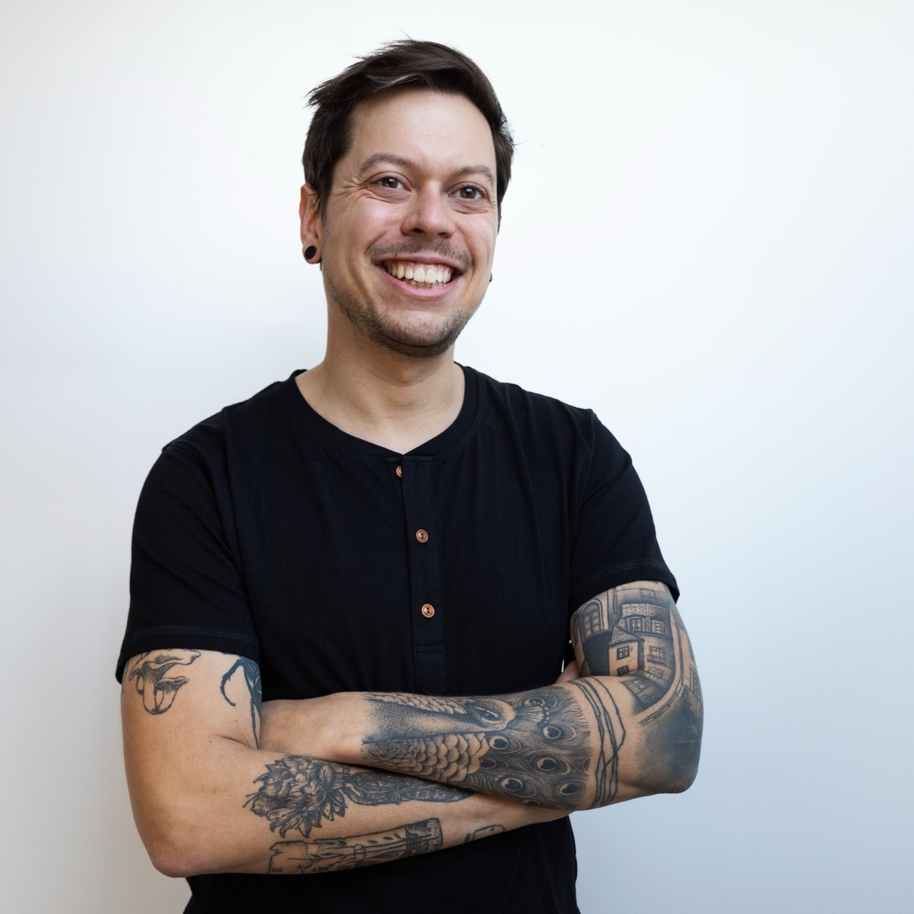

<Image align="right">

</Image>

## Salut, je suis Johan 👋

Je suis ingénieur logiciel, spécialisé dans le **développement de sites web et applications avec JavaScript**, React et NodeJS.

🎓 J'ai quitté ma Bretagne natale pour étudier en Picardie, où j'ai obtenu un DUT informatique à l'[Université Picardie Jules Verne d'Amiens](https://www.iut-amiens.fr/) puis un diplôme d'ingénieur en informatique de l'[Université de Technologie de Compiègne](https://www.utc.fr/). Dans le cadre de cette formation, j'ai eu l'opportunité de finir mes études à l'[Université Technique de Sofia](http://www.fuf.bg/fr) en Bulgarie.

🐘 De retour en France, je me suis installé à Nantes afin de commencer ma vie professionnelle. J'ai pu consolider mon expertise technique au sein de différentes entreprises du réseau numérique.

👨‍💻 Arrivé dans le développement par le front-end, je me suis perfectionné avec **React** puis j'ai rajouté d'autres cordes à mon arc : **NodeJS** pour le développement back-end, **React Native et Expo** pour les applications mobiles natives. De plus, j'ai toujours eu à coeur de mettre l'humain au coeur des processus de création, c'est pourquoi je suis très intéressé par la **gestion de produit agile** et la **conception d'interfaces accessibles** par toutes et tous.

🔥 Plus récemment, j'ai amélioré la qualité des projets que je maintiens grâce au développement piloté par les tests (unitaires et fonctionnels) et au compilateur TypeScript. Aussi, pour concevoir des sites statiques robustes et modernes, j'ai pris en main Gatsby et Next.js.

### Hors du code

🤝 Assez tôt, j'ai découvert le milieu associatif et je ne l'ai jamais vraiment quitté depuis. J'ai participé à des projets sociaux, en tant qu'animateur puis directeur de séjours de vacances pour enfants, culturels, en organisation des festivals de cinéma et de théatre, ou sportifs au sein des [Jules Vénères](https://www.instagram.com/narhrollerderby/), l'équipe mixte de roller derby nantaise, un sport de contact sur patins à roulettes avec laquelle je joue depuis 2014.

🌱 A titre personnel, je revendique l'égalité des personnes peut importe leur genre, leur origine, leur religion... ainsi que le respect de l'environnement et des animaux.

<Button href="/johan_soulet_resume.pdf" color="green">Télécharger mon CV (anglais)</Button>

