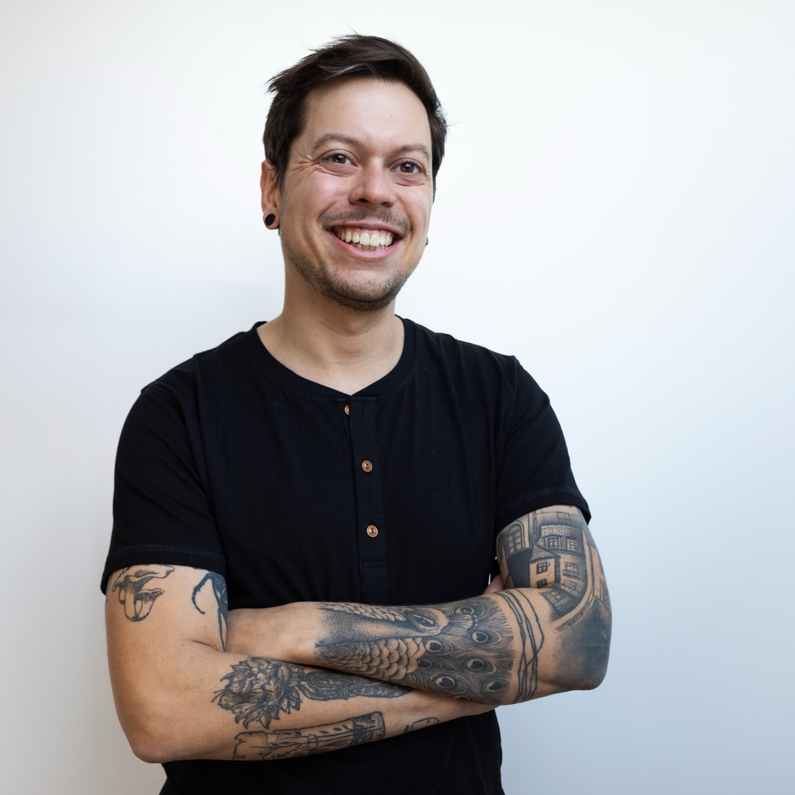

<Image align="right">

</Image>

## Hi, I'm Johan 👋

I am a software engineer specializing in **web development with JavaScript**, React and NodeJS.

🎓 I left my native Brittany to study in Picardy, where I earned a technical degree in computer science from [Université Picardie Jules Verne of Amiens](https://www.iut-amiens.fr/). I then graduated with an engineering a M.Eng in Computer Engineering from [Compiegne University of Technology](https://www.utc.fr/). As part of my degree, I had the opportunity to complete my studies at the [Technical University of Sofia](http://www.fuf.bg/fr) in Bulgaria.

🐘 After returning to France, I settled in Nantes to begin my professional career. Since then, I have strenghtened my technical extertise while working for several companies in the digital sector.

👨‍💻 I started my career as a front-end developer, specialyzing in **React**, before adding more strings to my bow : **NodeJS** for backend development, **React Native and Expo** for native mobile apps. I have always cared about putting people at the heart of the design process. This is why I am particularly interested in **agile product management** and building **accessible UI**.

🔥 Recently, I have improved the quality of the projects I maintain through test driven development (unit and functional testing) and TypeScript. I have also learned Gatsby and Next.js to build robust static websites.

### Beyond the code

🤝 I discovered the non-profit sector early in life and have remained involved ever since. I have contributed to social projects as a summer camp counsellor and director, to cultural projects by organizing short-film and theatre festivals, and to sports projects as a member of the [Jules Vénères](https://www.instagram.com/rollerderbynantesatlantique), the mixed-gender roller derby team from Nantes, and I have played with them since 2014.

🌱 On a personal level, I advocate for equal rights regardless of gender, background, or religion, as well as for the protection of the environment and animal welfare.

  <Button href="/johan_soulet_resume.pdf" color="green">
    Download my resume
  </Button>

